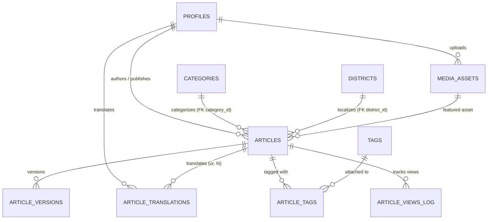

# Phase 7 — Database Architecture: Schema Blueprint & Migration Plan

**Project:** Kashmir Jammu Information Network (KJIN)  
**Deliverable:** Step 2 (Schema Design) & Step 3 (Gap Analysis & Migration Planning)  
**Database Target:** Supabase (PostgreSQL 15+)  
**Policy:** Zero resets, 100% additive migrations, zero production downtime, verified rollback plans.

---

## 1. Executive Summary & Design Decisions

Following the audit of all 21 existing migrations and application code contracts, this blueprint finalizes the data model for Phase 7 prior to executing any SQL against the live database (`ptvfidufwlswbjgsjvzl`).

### Key Decisions Settled:
1. **Independent Translation Lifecycle:**
   - Urdu (`ur`) and Hindi (`hi`) translations in `public.article_translations` now have an independent lifecycle status using the existing `public.article_status` enum (`'draft'`, `'review'`, `'published'`, `'archived'`).
   - A translation is only visible to anonymous readers if **both** the translation itself has `status = 'published'` **and** the parent article has `status = 'published'`.
   - Editorial attribution is maintained via `translator_id uuid REFERENCES public.profiles(id)`.
2. **Stable Identifiers for Taxonomy:**
   - Categories and Districts use stable, lowercase kebab-case `slug` values as durable primary keys/lookups matching [`apps/web/lib/taxonomy.ts`](file:///c:/Users/hafez/Desktop/websites/kjin/apps/web/lib/taxonomy.ts).
   - Localized Urdu and Hindi names are strictly display labels (`name_en`, `name_ur`, `name_hi`).
   - For all 20 districts, Jammu & Kashmir administrative division (`division CHECK (division IN ('Kashmir', 'Jammu'))`) is preserved.
   - Initial foreign keys `category_id` and `district_id` on `public.articles` are **nullable**, preserving 100% compatibility with existing text columns (`category`, `district`).
3. **Canonical Slugs Maintained:**
   - Urdu and Hindi web routes continue using the English canonical slug from `public.articles.slug`. No `localized_slug` column is introduced at this stage, preserving cross-language URL stability and search engine `hreflang` indexing.
4. **Multilingual Search Strategy:**
   - PostgreSQL's default `'english'` text search configuration does not parse or stem Urdu (Arabic script) or Hindi (Devanagari script) accurately.
   - Search vectors will combine PostgreSQL's `'simple'` dictionary (which tokenizes Unicode whitespace/punctuation without altering scripts) with `'english'` stemming for English fields, indexed via GIN.

---

## 2. Complete Entity-Relationship Model (Phase 7 Final Schema)



---

## 3. Detailed Table Specifications

### 3.1 `public.categories` (Lookup Table)
Stores standardized news categories seeded from [`taxonomy.ts`](file:///c:/Users/hafez/Desktop/websites/kjin/apps/web/lib/taxonomy.ts).

```sql
create table if not exists public.categories (
    id uuid primary key default gen_random_uuid(),
    slug text not null unique check (slug ~ '^[a-z0-9]+(?:-[a-z0-9]+)*$'),
    name_en text not null check (char_length(btrim(name_en)) > 0),
    name_ur text,
    name_hi text,
    description text not null default '',
    display_order integer not null default 0,
    is_active boolean not null default true,
    created_at timestamptz not null default now(),
    updated_at timestamptz not null default now()
);
```

- **Initial Seed Data (9 Categories):**
  1. `politics` ('Politics', 'سیاست', 'राजनीति', order: 1)
  2. `local` ('Local', 'مقامی خبریں', 'स्थानीय', order: 2)
  3. `economy` ('Economy', 'معیشت', 'अर्थव्यवस्था', order: 3)
  4. `culture` ('Culture', 'ثقافت و ادب', 'संस्कृति', order: 4)
  5. `sports` ('Sports', 'کھیل', 'खेल', order: 5)
  6. `education` ('Education', 'تعلیم', 'शिक्षा', order: 6)
  7. `investigation` ('Investigation', 'تحقیقاتی رپورٹنگ', 'जांच', order: 7)
  8. `opinion` ('Opinion', 'اداریہ و آراء', 'विचार', order: 8)
  9. `general` ('General', 'عام خبریں', 'सामान्य', order: 9)

### 3.2 `public.districts` (Lookup Table)
Stores all 20 official Jammu & Kashmir districts seeded from [`taxonomy.ts`](file:///c:/Users/hafez/Desktop/websites/kjin/apps/web/lib/taxonomy.ts).

```sql
create table if not exists public.districts (
    id uuid primary key default gen_random_uuid(),
    slug text not null unique check (slug ~ '^[a-z0-9]+(?:-[a-z0-9]+)*$'),
    name_en text not null check (char_length(btrim(name_en)) > 0),
    name_ur text,
    name_hi text,
    division text not null check (division in ('Kashmir', 'Jammu')),
    display_order integer not null default 0,
    is_active boolean not null default true,
    created_at timestamptz not null default now(),
    updated_at timestamptz not null default now()
);
```

- **Initial Seed Data (20 Districts):**
  - **Kashmir Division (10):** `srinagar`, `anantnag`, `baramulla`, `budgam`, `bandipora`, `ganderbal`, `kulgam`, `kupwara`, `pulwama`, `shopian`.
  - **Jammu Division (10):** `jammu`, `doda`, `kathua`, `kishtwar`, `poonch`, `rajouri`, `ramban`, `reasi`, `samba`, `udhampur`.

### 3.3 Additions to `public.articles`
Additive foreign keys referencing the lookup tables without breaking existing text columns:

```sql
alter table public.articles
    add column if not exists category_id uuid references public.categories(id) on delete set null,
    add column if not exists district_id uuid references public.districts(id) on delete set null;

create index if not exists idx_articles_category_id on public.articles (category_id);
create index if not exists idx_articles_district_id on public.articles (district_id);
```

### 3.4 `public.tags` & `public.article_tags` (Tagging Subsystem)
Enables topic clustering, related article recommendations, and indexing.

```sql
create table if not exists public.tags (
    id uuid primary key default gen_random_uuid(),
    slug text not null unique check (slug ~ '^[a-z0-9]+(?:-[a-z0-9]+)*$'),
    name_en text not null check (char_length(btrim(name_en)) > 0),
    name_ur text,
    name_hi text,
    created_at timestamptz not null default now()
);

create table if not exists public.article_tags (
    article_id uuid not null references public.articles(id) on delete cascade,
    tag_id uuid not null references public.tags(id) on delete cascade,
    created_at timestamptz not null default now(),
    primary key (article_id, tag_id)
);

create index if not exists idx_article_tags_tag_id on public.article_tags (tag_id);
create index if not exists idx_article_tags_article_id on public.article_tags (article_id);
```

### 3.5 `public.media_assets` (Newsroom Asset Library)
Centralized catalog of photos, infographics, and report assets with localized accessibility text.

```sql
create table if not exists public.media_assets (
    id uuid primary key default gen_random_uuid(),
    storage_bucket text not null default 'news-media',
    storage_path text not null unique,
    public_url text not null,
    alt_text_en text not null default '',
    alt_text_ur text,
    alt_text_hi text,
    caption text,
    credit text,
    width integer check (width is null or width > 0),
    height integer check (height is null or height > 0),
    file_size_bytes bigint check (file_size_bytes is null or file_size_bytes > 0),
    mime_type text not null check (mime_type in ('image/jpeg', 'image/png', 'image/webp', 'image/avif', 'image/svg+xml')),
    uploaded_by uuid references public.profiles(id) on delete set null,
    created_at timestamptz not null default now(),
    updated_at timestamptz not null default now()
);

create index if not exists idx_media_assets_uploaded_by on public.media_assets (uploaded_by);
create index if not exists idx_media_assets_created_at on public.media_assets (created_at desc);
```

### 3.6 Enhanced `public.article_translations`
Extends the existing table to support independent publication status, translator attribution, and localized SEO meta headers.

```sql
alter table public.article_translations
    add column if not exists status public.article_status not null default 'draft',
    add column if not exists translator_id uuid references public.profiles(id) on delete set null,
    add column if not exists meta_title text,
    add column if not exists meta_description text,
    add column if not exists published_at timestamptz,
    add column if not exists published_by uuid references public.profiles(id) on delete set null;

-- Add check constraints for metadata bounds
alter table public.article_translations
    add constraint article_translations_meta_title_len check (meta_title is null or char_length(meta_title) <= 255),
    add constraint article_translations_meta_desc_len check (meta_description is null or char_length(meta_description) <= 1000);

create index if not exists idx_article_translations_status on public.article_translations (status);
```

---

## 4. Security, RLS Policies & Storage Access

### 4.1 Row Level Security (RLS) Rules

1. **`categories` & `districts`:**
   - `SELECT`: Allowed for all (`anon`, `authenticated`). Public readers must be able to resolve category and district names.
   - `INSERT / UPDATE / DELETE`: Restricted to editors and admins (`public.user_has_editor_access()`).
2. **`tags` & `article_tags`:**
   - `tags` SELECT: Allowed for all (`anon`, `authenticated`). Mutations: `public.user_has_editor_access()`.
   - `article_tags` SELECT: Allowed if the parent article is published (`exists (select 1 from public.articles a where a.id = article_tags.article_id and a.status = 'published')`) or if user is an editor. Mutations: via CMS RPCs or editor role.
3. **`media_assets`:**
   - `SELECT`: Allowed for all (`anon`, `authenticated`). Published news photos must render for readers.
   - `INSERT`: Allowed for authenticated employees with `article.create` permission (`public.has_permission('article.create')`).
   - `UPDATE / DELETE`: Allowed for uploader or editors (`uploaded_by = auth.uid() or public.user_has_editor_access()`).
4. **`article_translations` (Updated Security Policy):**
   - Replace the legacy policy with the independent publication rule:
   ```sql
   drop policy if exists "Translations are readable if article is readable" on public.article_translations;
   drop policy if exists "Published translations of published articles are public" on public.article_translations;

   create policy "Published translations of published articles are public"
   on public.article_translations
   for select
   using (
       (
           status = 'published'
           and exists (
               select 1 from public.articles a 
               where a.id = article_translations.article_id
                 and a.status = 'published'
           )
       )
       or public.user_has_editor_access()
       or translator_id = (select auth.uid())
   );
   ```

### 4.2 Storage Access Policies (`storage.objects`)
Database tables store file metadata (`public.media_assets`), but physical binaries reside in Supabase Storage bucket `news-media`.
- **Bucket Configuration:** `public = true` (enables CDN delivery of approved news images).
- **Storage Policies:**
  - `storage.objects` SELECT: `bucket_id = 'news-media'` is public.
  - `storage.objects` INSERT: `bucket_id = 'news-media'` restricted to `authenticated` users who have an active profile in `public.profiles`.
  - Allowed MIME types: `image/webp`, `image/jpeg`, `image/png`, `image/avif`.
  - Max file size: `10MB`.

---

## 5. Search Vector & Indexing Strategy

### The Multilingual Challenge
PostgreSQL's default `'english'` text search parser strips diacritics and attempts English Porter stemming. If applied to Urdu or Hindi, it fails to produce useful lexemes and can misinterpret characters.

### The Solution: Combined Simple + English Vectors
1. **On `public.articles` (English Source):**
   ```sql
   alter table public.articles add column if not exists tsv_search tsvector
   generated always as (
       setweight(to_tsvector('english', coalesce(title, '')), 'A') ||
       setweight(to_tsvector('simple', coalesce(title, '')), 'A') ||
       setweight(to_tsvector('english', coalesce(excerpt, '')), 'B') ||
       setweight(to_tsvector('english', coalesce(content, '')), 'C')
   ) stored;

   create index if not exists idx_articles_tsv_search on public.articles using gin (tsv_search);
   ```
2. **On `public.article_translations` (Urdu & Hindi Translations):**
   Using `'simple'` parses raw Unicode tokens verbatim, allowing exact-word match lookups across Arabic (Urdu) and Devanagari (Hindi) scripts:
   ```sql
   alter table public.article_translations add column if not exists tsv_search tsvector
   generated always as (
       setweight(to_tsvector('simple', coalesce(title, '')), 'A') ||
       setweight(to_tsvector('simple', coalesce(excerpt, '')), 'B') ||
       setweight(to_tsvector('simple', coalesce(content, '')), 'C')
   ) stored;

   create index if not exists idx_article_translations_tsv_search on public.article_translations using gin (tsv_search);
   ```

---

## 6. Migration Sequence & Rollback Plan

### Sequence Overview (5 Incremental Migrations)

| Migration # | Filename | Scope | Safety & Invariant |
|---|---|---|---|
| **M1** | `20261012100000_categories_and_districts.sql` | Create & seed `categories` and `districts`; add nullable `category_id`, `district_id` to `articles`; run safe backfill. | **Additive.** Retains existing text columns `category` and `district`. |
| **M2** | `20261012110000_tags_and_article_tags.sql` | Create `tags` and `article_tags` junction table with RLS and composite uniqueness. | **Additive.** New tables only. |
| **M3** | `20261012120000_media_assets.sql` | Create `media_assets` table with image dimensions, localized alt text, and uploader attribution. | **Additive.** New table only. |
| **M4** | `20261012130000_translation_workflow.sql` | Add `status`, `translator_id`, `meta_title`, `meta_description`, `published_at` to `article_translations`; update RLS policy and `upsert_article_translation` RPC. | **Non-destructive.** Backfills existing translations to `published` if parent article is published. |
| **M5** | `20261012140000_multilingual_search_indexing.sql` | Add stored `tsv_search` generated columns and GIN indexes on `articles` and `article_translations`. | **Performance.** Uses `STORED` generated columns and GIN indexes. |

---

### Migration 1 Preview & Backfill Logic
```sql
-- Migration 1: Categories and Districts
-- Creates normalized lookup tables and maps existing text columns

-- 1. Create categories
create table if not exists public.categories ( ... );
-- 2. Seed 9 categories from taxonomy.ts
insert into public.categories (slug, name_en, name_ur, name_hi, description, display_order) values
  ('politics', 'Politics', 'سیاست', 'राजनीति', 'Governance, policy, and public affairs reporting across J&K.', 1),
  ('local', 'Local', 'مقامی خبریں', 'स्थानीय', 'Ground reporting, civic issues, and grassroots updates from districts.', 2),
  ('economy', 'Economy', 'معیشت', 'अर्थव्यवस्था', 'Business, agriculture, tourism, and financial developments.', 3),
  ('culture', 'Culture', 'ثقافت و ادب', 'संस्कृति', 'Heritage, literature, arts, and traditions of Jammu and Kashmir.', 4),
  ('sports', 'Sports', 'کھیل', 'खेल', 'Athletics, youth sports, and regional championships.', 5),
  ('education', 'Education', 'تعلیم', 'शिक्षा', 'Schools, universities, and academic affairs.', 6),
  ('investigation', 'Investigation', 'تحقیقاتی رپورٹنگ', 'जांच', 'In-depth investigative journalism and accountability reporting.', 7),
  ('opinion', 'Opinion', 'اداریہ و آراء', 'विचार', 'Editorials, columns, and analytical perspectives.', 8),
  ('general', 'General', 'عام خبریں', 'सामान्य', 'General regional news and public interest bulletins.', 9)
on conflict (slug) do nothing;

-- 3. Create districts
create table if not exists public.districts ( ... );
-- 4. Seed 20 districts from taxonomy.ts
insert into public.districts (slug, name_en, name_ur, name_hi, division, display_order) values
  ('srinagar', 'Srinagar', 'سری نگر', 'श्रीनगर', 'Kashmir', 1),
  ('anantnag', 'Anantnag', 'اننت ناگ', 'अनंतनाग', 'Kashmir', 2),
  ('baramulla', 'Baramulla', 'بارہمولہ', 'बारामूला', 'Kashmir', 3),
  ('budgam', 'Budgam', 'بڈگام', 'बडगाम', 'Kashmir', 4),
  ('bandipora', 'Bandipora', 'بانڈی پورہ', 'बांडीपोरा', 'Kashmir', 5),
  ('ganderbal', 'Ganderbal', 'گاندربل', 'गांदरबल', 'Kashmir', 6),
  ('kulgam', 'Kulgam', 'کولگام', 'कुलगाम', 'Kashmir', 7),
  ('kupwara', 'Kupwara', 'کپوارہ', 'कुपवाड़ा', 'Kashmir', 8),
  ('pulwama', 'Pulwama', 'پلوامہ', 'पुलवामा', 'Kashmir', 9),
  ('shopian', 'Shopian', 'شوپیاں', 'शोपियां', 'Kashmir', 10),
  ('jammu', 'Jammu', 'جموں', 'जम्मू', 'Jammu', 11),
  ('doda', 'Doda', 'ڈوڈہ', 'डोडा', 'Jammu', 12),
  ('kathua', 'Kathua', 'کٹھوعہ', 'कठुआ', 'Jammu', 13),
  ('kishtwar', 'Kishtwar', 'کشتواڑ', 'किश्तवाड़', 'Jammu', 14),
  ('poonch', 'Poonch', 'پونچھ', 'पुंछ', 'Jammu', 15),
  ('rajouri', 'Rajouri', 'راجوری', 'राजौरी', 'Jammu', 16),
  ('ramban', 'Ramban', 'رام بن', 'रामबन', 'Jammu', 17),
  ('reasi', 'Reasi', 'ریاسی', 'रियासी', 'Jammu', 18),
  ('samba', 'Samba', 'سامبا', 'सांबा', 'Jammu', 19),
  ('udhampur', 'Udhampur', 'ادھم پور', 'उधमपुर', 'Jammu', 20)
on conflict (slug) do nothing;

-- 5. Add nullable foreign keys to articles
alter table public.articles
  add column if not exists category_id uuid references public.categories(id) on delete set null,
  add column if not exists district_id uuid references public.districts(id) on delete set null;

-- 6. Backfill existing articles
update public.articles a
set category_id = c.id
from public.categories c
where (lower(trim(a.category)) = c.slug or lower(trim(a.category)) = lower(c.name_en))
  and a.category_id is null;

update public.articles a
set district_id = d.id
from public.districts d
where (lower(trim(coalesce(a.district, ''))) = d.slug or lower(trim(coalesce(a.district, ''))) = lower(d.name_en))
  and a.district_id is null;
```

---

### Rollback Strategy per Migration

| Migration | Rollback Action | Risk to Core Articles |
|---|---|---|
| **M1** | `alter table public.articles drop column if exists category_id, drop column if exists district_id; drop table if exists public.categories, public.districts cascade;` | **Zero.** Core `articles.category` and `articles.district` text columns remain completely intact. |
| **M2** | `drop table if exists public.article_tags, public.tags cascade;` | **Zero.** Standalone junction and table. |
| **M3** | `drop table if exists public.media_assets cascade;` | **Zero.** Standalone asset table; `articles.featured_image_url` remains unaffected. |
| **M4** | `alter table public.article_translations drop column if exists status, drop column if exists translator_id, drop column if exists meta_title, drop column if exists meta_description, drop column if exists published_at, drop column if exists published_by;` (restore prior RLS policy). | **Low.** Original translation text (`title`, `excerpt`, `content`) remains untouched. |
| **M5** | `alter table public.articles drop column if exists tsv_search; alter table public.article_translations drop column if exists tsv_search;` | **Zero.** Search vectors are purely derived. |

---

## 7. Next Steps Checklist

- [x] Step 1: Audit existing database schema and migrations.
- [x] Step 2: Finalize schema design and entity relationships.
- [x] Step 3: Complete gap analysis and migration sequence planning.
- [ ] Step 4: Author migration SQL files in `supabase/migrations/` (M1 through M5).
- [ ] Step 5: Write and execute tests to verify RLS, translation visibility, and zero regression against existing web application queries.
